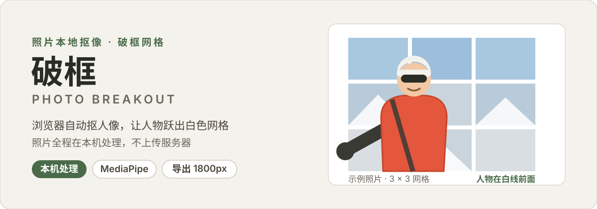
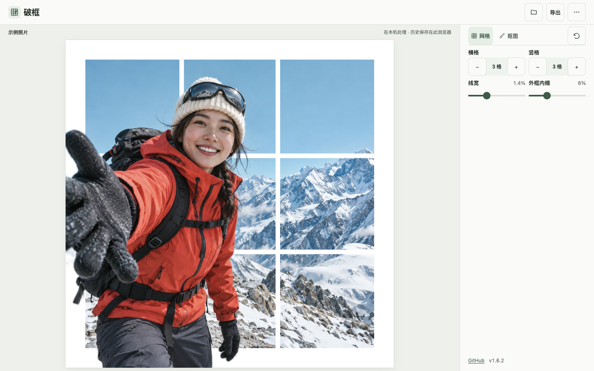
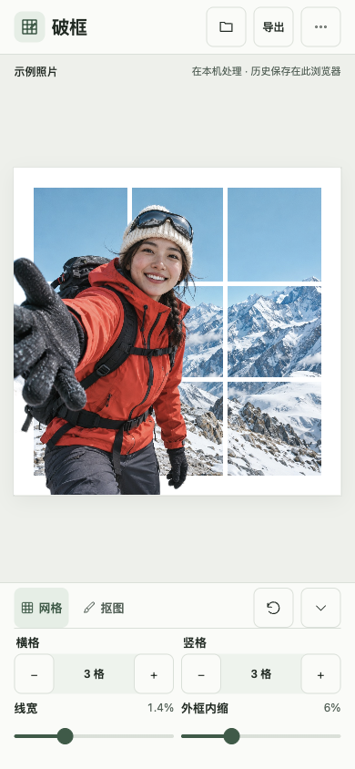

<p align="right"><a href="README.md">中文</a></p>

<p align="center">
  
</p>

<p align="center">
  <a href="https://xiaosang.cc/photo-breakout/">▶ Try Online</a>
  ·
  <a href="https://github.com/holynova/photo-breakout">GitHub Repository</a>
</p>

Photo Breakout is a local photo editor for breakout grids: try the sample photo or follow the three-step guide with your own. The browser segments the person on-device so they appear in front of the white grid — a "breaking out" effect. Rows, columns, line width, and frame are all adjustable; export as PNG. Photos never leave your machine.


[Watch the 18-second introduction](https://github.com/holynova/photo-breakout/releases/tag/v1.6.2)

## Screenshots

<p align="center">
  
</p>

<p align="center">
  
</p>

## Features

- **On-device segmentation**: Google MediaPipe SelfieMulticlass recognizes the person in the browser (hair, skin, clothing, and accessories all count as foreground); the person is placed in front of the white lines automatically.
- **Adjustable grid**: rows and columns independently (default 3 × 3); line width 0.3–4 (default 1.4); frame inset 1–18 (default 6).
- **Brush touch-up**: paint the photo to mark where the person covers the white lines; keyboard refinement supported.
- **Multi-photo**: import several photos at once and switch between local edits; history lives in the current browser.
- **Export**: PNG, longest edge up to 1800 px.
- **Three-step guide**: built-in sample photo and three-step walkthrough, so you can get started on first open.

## Privacy & Performance

- Photos and masks are processed locally; history lives in the current browser — clearing site data removes it.
- The MediaPipe model and runtime load the first time you open one of your own photos (the model is ~16 MB, then comes from browser cache); they load only when segmentation is needed, not with the page.
- Umami records page visits and share-tool actions.

## Run Locally

```bash
npm ci
npm run dev
```

Check: `npm run check` (syntax check + build).

## Tech

- Zero frameworks: vanilla HTML/CSS/JavaScript; MediaPipe Tasks Vision (`@mediapipe/tasks-vision` 0.10.32), CPU inference, working image capped at 512 px on the long edge.
- Model: Google MediaPipe SelfieMulticlass 256×256 float32, Apache 2.0, see `public/model/SOURCE.txt`; the runtime is also Apache 2.0.
- The test photo in the screenshots was generated by ImageGen.

```
public/index.html   Entry
src/app.js          Editor: grid, brush, history, export
src/segment.js      MediaPipe person segmentation
src/history.js      Local history
src/share.js        Sharing
src/download.js     PNG export
public/model/       SelfieMulticlass model (~16 MB) + license notes
public/sample/      Sample photo and guide images
```
