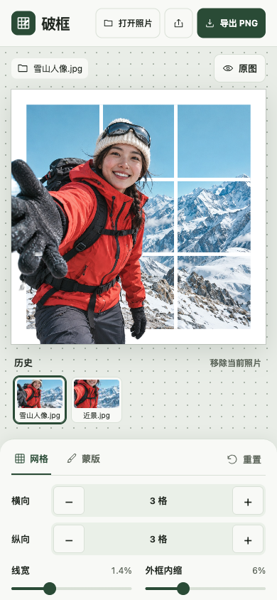

# 破框 · Photo Breakout

把照片变成破框图。浏览器自动识别人像，让手、衣服和头发遮住白色分隔线。横纵格数各自可设为 1–12 格，默认 3 × 3。可一次打开多张照片，切换本机历史、修正人物蒙版，再导出 PNG。分享按钮可复制工具链接或下载二维码卡片。

Make a breakout photo with white grid lines behind the person. Adjust the rows and columns independently, import multiple photos, switch between local edits, touch up the mask, and export a PNG. The share button provides a link and a downloadable QR card.



[桌面工作台截图 / Desktop screenshot](./assets/screenshot-desktop.png)

- [Cloudflare Demo](https://xiaosang.cc/photo-breakout/)
- [GitHub Repo](https://github.com/holynova/photo-breakout)


## 本地运行 / Run locally

```sh
npm ci
npm run dev
```

照片和蒙版在本机处理，历史保存在当前浏览器，清除网站数据会移除历史。Umami 记录页面访问和分享工具操作。首次打开自选照片时会加载 MediaPipe 模型及运行库，模型约 16 MB。PNG 导出长边最高 1800 像素。

## 发布 / Deploy

Cloudflare Workers Static Assets 由 `xiaosang-portfolio` 提供，公开路径为 `/photo-breakout/`。从 `main` 构建，并将产物同步到作品集 `master`。

```sh
npm run check
npm run deploy:check
npm run stage:portfolio -- /path/to/holynova.github.io
```

在作品集仓库提交并推送 `photo-breakout/` 后，从同一提交按作品集 README 组装部署目录（包括该 Worker 上的其他应用），再执行手动部署。

```sh
npx --yes wrangler@4.128.0 deploy --dry-run --config wrangler.jsonc
npx --yes wrangler@4.128.0 deploy --config wrangler.jsonc
```

截图中的测试照片由 ImageGen 生成。人像分割使用 Google MediaPipe SelfieMulticlass，运行库和模型采用 Apache 2.0。 [MediaPipe 模型卡](https://storage.googleapis.com/mediapipe-assets/Model%20Card%20Multiclass%20Segmentation.pdf)
