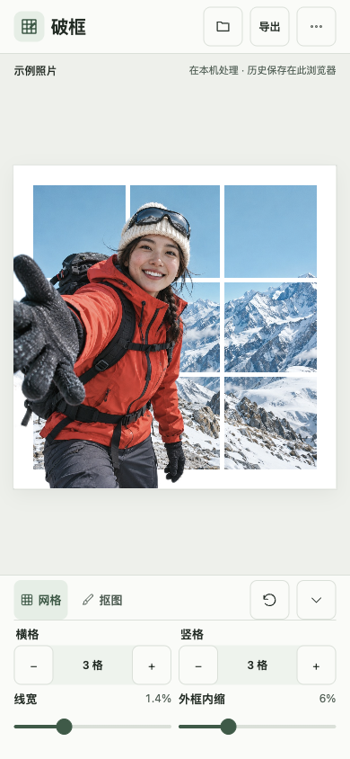

<p align="right"><a href="README.en.md">English</a></p>

<p align="center">
  
</p>

<p align="center">
  <a href="https://xiaosang.cc/photo-breakout/">▶ 在线体验</a>
  ·
  <a href="https://github.com/holynova/photo-breakout">GitHub 仓库</a>
</p>

破框是一款照片本地抠像与破框网格编辑器：打开网页试用示例照片，或跟着三步教程导入自己的照片；浏览器自动识别人像，让人物遮住白色分隔线，做出人物"跃出"网格的效果。横纵格数、线宽、外框都可调，调好导出 PNG。照片全程在本机处理。

## 截图

<p align="center">
  
</p>

<p align="center">
  
</p>

## 功能

- **本地自动抠像**：Google MediaPipe SelfieMulticlass 在浏览器内识别人像（头发、皮肤、衣物、配饰均为前景），人物自动置于白线前面。
- **网格可调**：横格、竖格各自增减（默认 3 × 3）；线宽 0.3–4（默认 1.4）；外框内缩 1–18（默认 6）。
- **画笔修整**：涂抹照片，标记挡住白线的位置；也支持键盘修整。
- **多张导入**：一次导入多张照片，在本机历史中切换；历史保存在当前浏览器。
- **导出 PNG**：长边最高 1800 像素。
- **三步教程**：内置示例照片与三步引导，第一次打开就能上手。

## 隐私与性能

- 照片和蒙版都在本机处理，历史保存在当前浏览器；清除网站数据会移除历史。
- 首次打开自选照片时加载 MediaPipe 模型及运行库（模型约 16 MB，之后走浏览器缓存）；只在需要抠像时加载，不随页面加载。
- Umami 记录页面访问和分享工具操作。

## 本地运行

```bash
npm ci
npm run dev
```

检查：`npm run check`（语法检查 + 构建）。

## 技术

- 零框架：原生 HTML/CSS/JavaScript；MediaPipe Tasks Vision（`@mediapipe/tasks-vision` 0.10.32）CPU 推理，工作图最长边 512 像素。
- 模型：Google MediaPipe SelfieMulticlass 256×256 float32，Apache 2.0，见 `public/model/SOURCE.txt`；运行库同样 Apache 2.0。
- 截图中的测试照片由 ImageGen 生成。

```
public/index.html   入口
src/app.js          编辑器：网格、画笔、历史、导出
src/segment.js      MediaPipe 人像分割
src/history.js      本机历史
src/share.js        分享
src/download.js     PNG 导出
public/model/       SelfieMulticlass 模型（约 16 MB）+ 授权说明
public/sample/      示例照片与引导图
```
